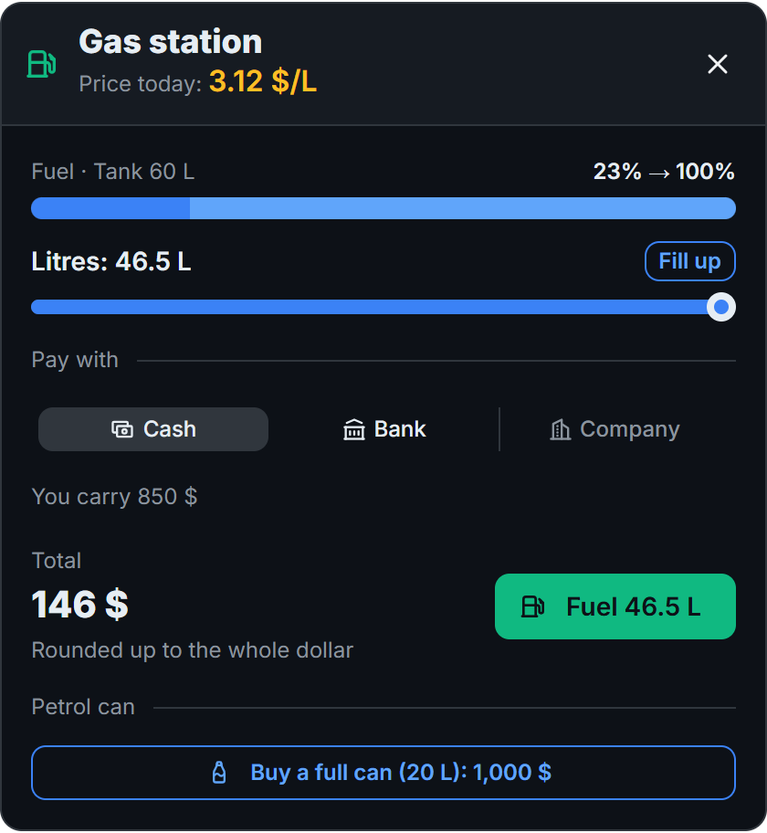

# B&N Fuel

B&N Fuel is a complete fuel system for Qbox servers. It replaces ox_fuel with fuel consumption, gas stations whose price changes every day, fuelling by the litre, cash, bank and company payments, a petrol can and an in-game admin panel.

## Features

- **Pay for what went in:** players pick the litres, and stopping early only charges for what entered the tank.
- **Daily prices:** each station has its own base price, which moves every day within a limit you set.
- **Three ways to pay:** cash, bank, or the company account for vehicles of the job's fleet.
- **Petrol can:** buy it or refill it at the pump, then pour it into any vehicle.
- **ox_target or Text UI:** switch between them from the panel, with no restart.
- **Admin panel:** manage stations, fleets, tanks, prices, colours and logs in game.
- **Any bank:** each bank is one open file, so you can add your own.
- **Any language:** English and Spanish are included, and a new language is one extra file.
- **Discord logs:** fuelling, petrol cans and panel use, each with its own optional channel.

## Requirements

`qbx_core`, `ox_lib` and `ox_inventory`. All of them ship with a standard Qbox server.

Optional:

- `ox_target`, only for the ox_target interaction mode.
- `Renewed-Banking`, the default bank for company payments. To use a different one, see [Using another bank](banks.md).

No database tables are needed.

## Where to start

Follow the [installation](installation.md), then open the [admin panel](admin-panel.md) with `/admin:fuel`.
