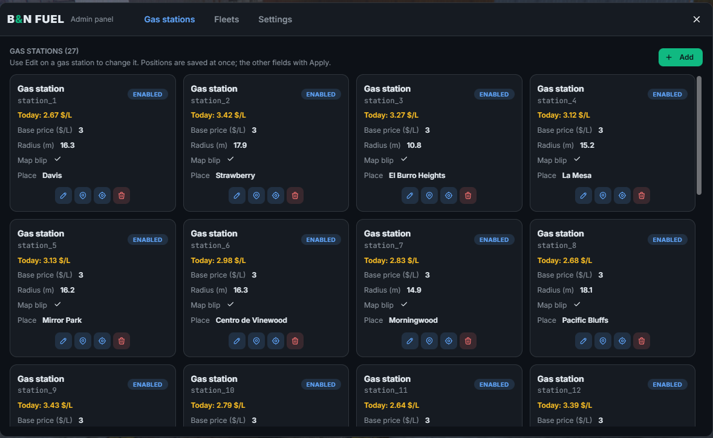
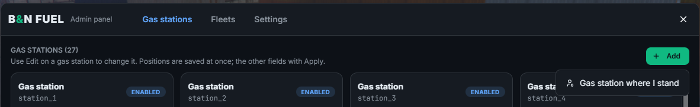
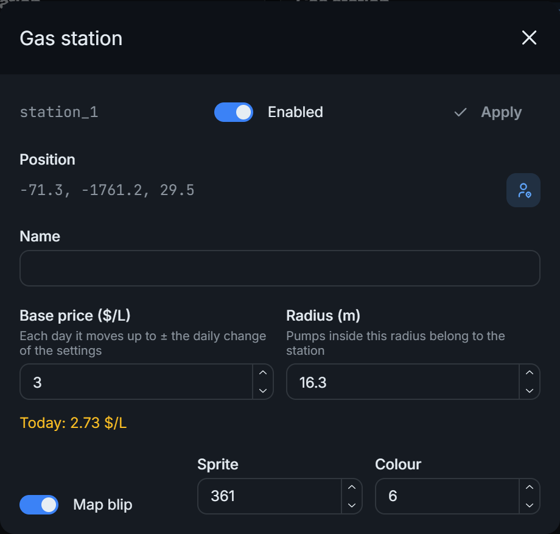
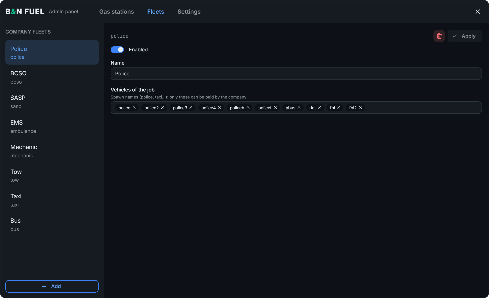
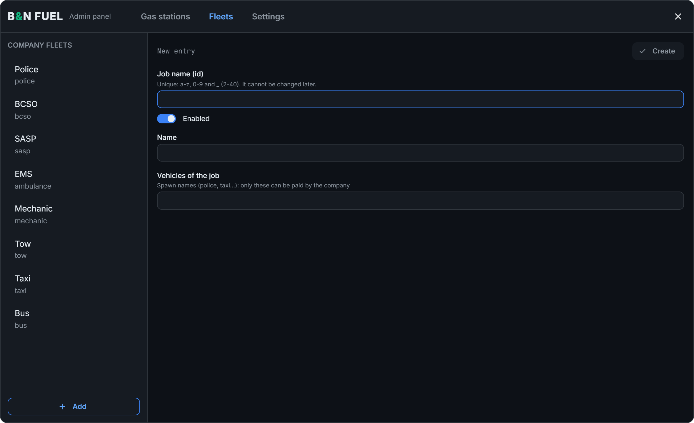

# Admin panel

Open it with `/admin:fuel`. Changes apply to everyone at once, with no restart.

## Who can open it

By default, a player needs both of these:

- **The `group.admin` permission.** Change the group with **Admin group (principal)** in the Settings tab.
- **Opt-in with qbx_core**, using `/optin`.

qbx_core only counts a player with the `admin` ace as opted in, so a custom admin group needs that ace too.

To change this, edit `shared/config.lua`:

| Option | What it does |
|---|---|
| `Shared.AdminCommand` | The name of the panel command |
| `Shared.RequireOptin = false` | No opt-in needed to use the panel |
| `Shared.OptinCommand` | The opt-in command shown in the warning, without the `/`. It only changes the text: bn_fuel does not create this command |

To use your own opt-in system, set `Shared.OptinCommand` and edit `Bridge.isOptin` in `bridge/framework.lua` to check it.

## Gas stations

One card per station, with its name, today's price, base price, radius, blip and place.

Each card has four buttons:

| Button | What it does |
|---|---|
| Edit | Opens the station's window |
| GPS | Sets a waypoint to the station |
| Teleport | Takes you to the station |
| Delete | Deletes the station. Double click to confirm |

**To add a station,** stand where you want it and use **Gas station where I stand**. It starts with a base price of 3 $/L and a radius of 15 m.

In the Edit window you can change the following:

- **Enabled:** a disabled station cannot be used.
- **Name:** leave it empty to show "Gas station" in the player's language.
- **Base price:** the price per litre before the daily change. The window shows today's price.
- **Radius:** pumps inside this radius belong to the station.
- **Map blip:** on or off, with its sprite and colour.
- **Position:** moves the station to where you stand.

Positions are saved at once. The other fields are saved with **Apply**.

## Fleets

A fleet lists the vehicles a job's company account can pay for. Add one with the **job name** as its id, then list the vehicle spawn names (`police`, `taxi`...). The id cannot be changed later.

The police jobs included (`police`, `bcso`, `sasp`) start with the same vehicles. Change each one to suit your server.

## Settings

Everything in this tab is explained in [Settings](settings.md).
