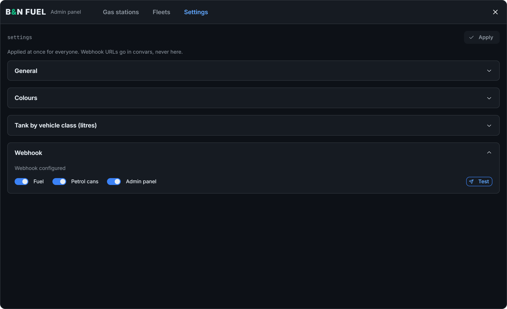

# Discord logs

bn_fuel can send fuelling, petrol can and admin panel activity to Discord.

## Setting the webhooks

Webhook URLs are set with convars in your `server.cfg`, never in the resource's files:

```
set bn_fuel:webhook "URL"         # used by any channel without its own URL
set bn_fuel:webhook:fuel "URL"    # fuelling
set bn_fuel:webhook:can "URL"     # petrol cans
set bn_fuel:webhook:panel "URL"   # admin panel
```

You only need the first line to send everything to one channel.

## Turning logs on and off

In `/admin:fuel` > Settings > Webhook, each type of log has its own switch. **Test** sends a message to your webhooks, so you can check them.


