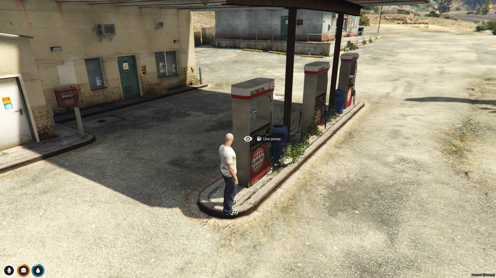
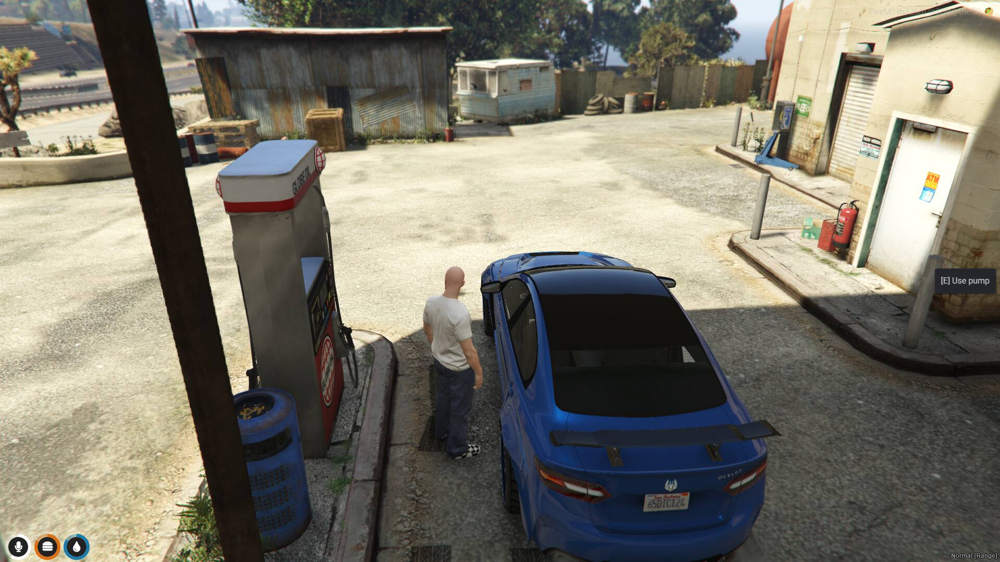
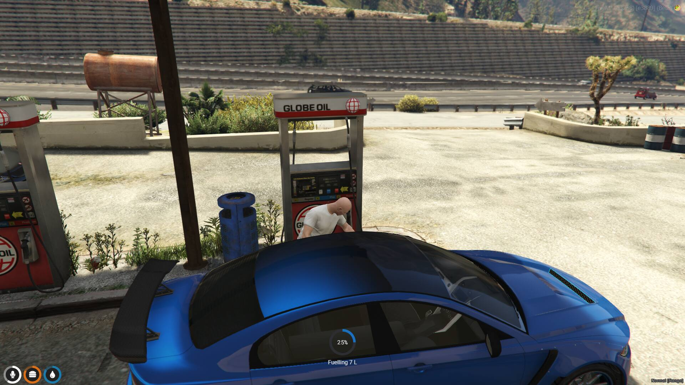
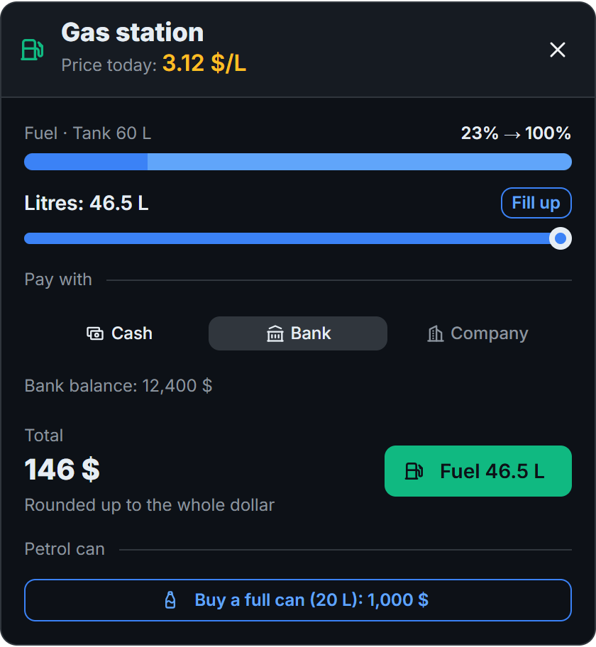
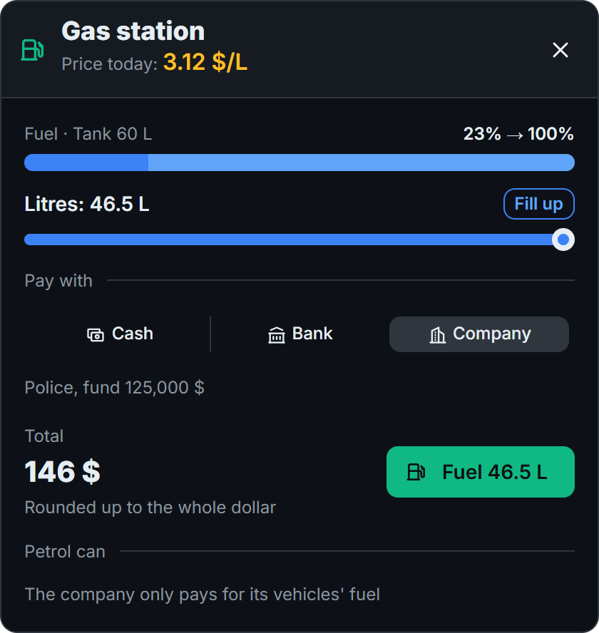
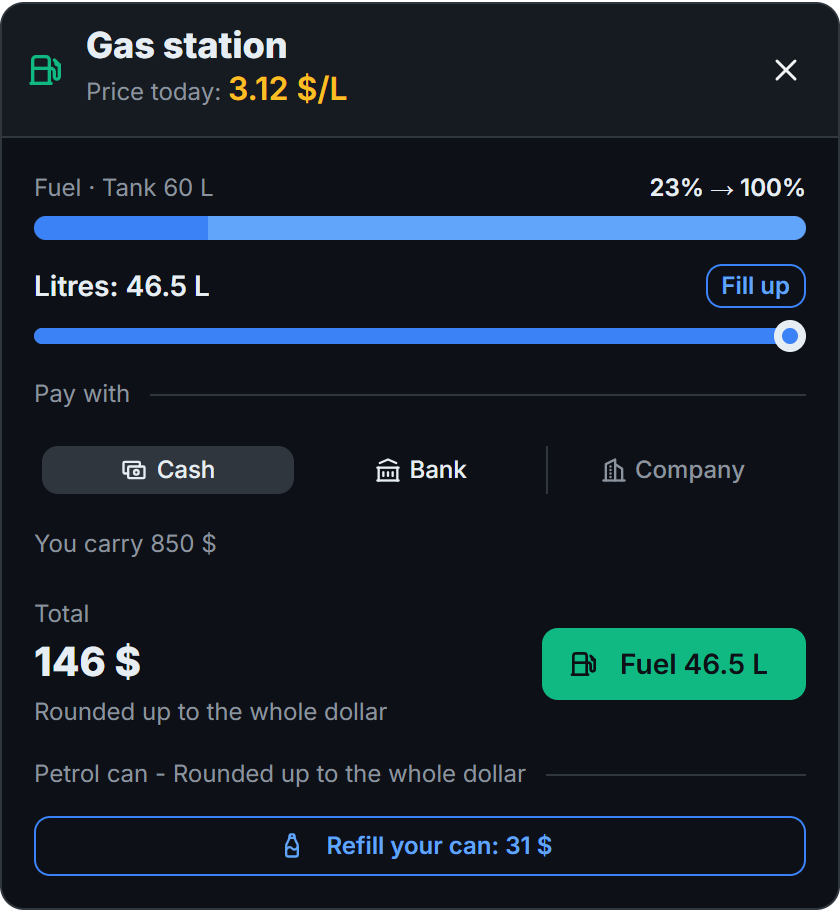
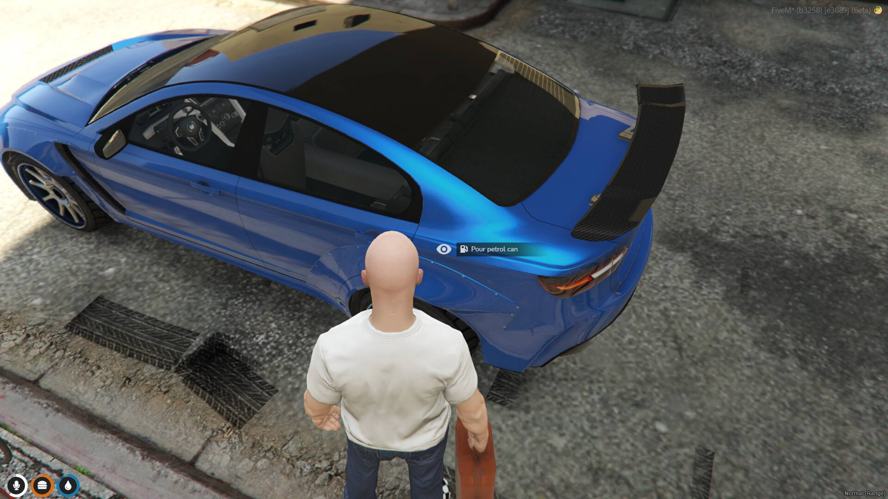
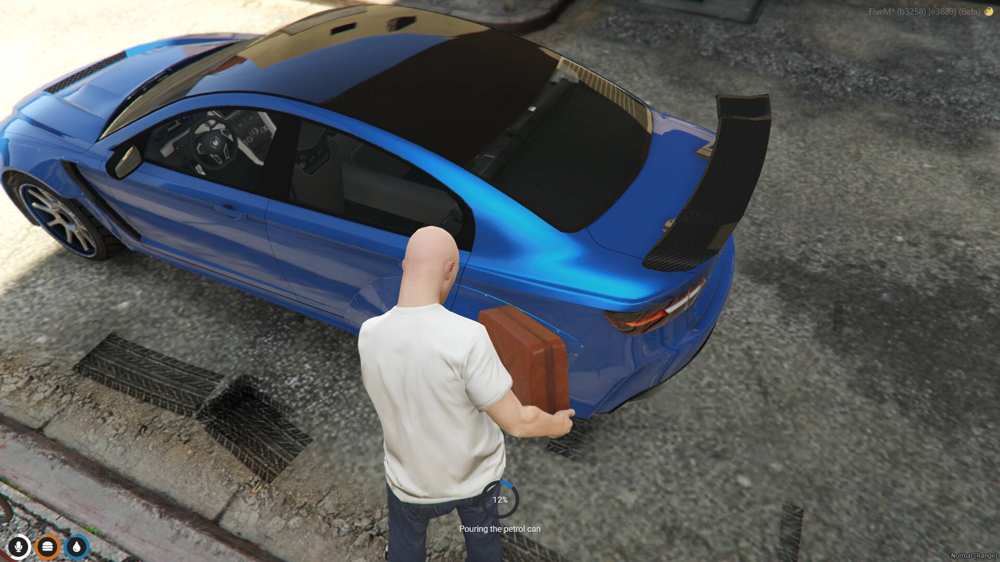

# Fuelling and petrol cans

## Fuelling a vehicle

1. Park next to a pump and get out of the vehicle.
2. Use the pump, with ox_target or the Text UI key.
3. Pick the litres and how to pay.

Fuelling takes litres ÷ `litresPerSecond` seconds, 2 litres per second by default. If the player stops early, only what went in is charged.

## Prices

- **Daily price:** each station has a base price per litre. Every day it moves up to ± `priceVariation` %, separately for each station. The default is 15 %.
- **Rounding:** every total is rounded up to the whole dollar, and the pump screen says so. 1 L at 2.58 $ costs 3 $.
- **Litres:** the tank size depends on the vehicle class. You can change it in [Settings](settings.md#tanks).

## Ways to pay

| Method | Where the money comes from |
|---|---|
| Cash | The `money` item of ox_inventory |
| Bank | The player's bank account (by default, the qbx_core one) |
| Company | The job account in your bank (by default, Renewed-Banking) |

The Company option is only available when all of these are true:

- The player's job has an enabled fleet in the panel.
- The vehicle's model is in that fleet.
- The player is on duty, if `societyRequireDuty` is on.

## Petrol can

The can is bought or refilled at the pump, with cash or bank. A company account cannot pay for it.

- **Refill:** the price is the missing litres at the station's price today. It uses the can in the player's hands unless it is full; otherwise, the emptiest one in the inventory.
- **Buy:** a new can is only offered when none needs refilling. It costs `canPrice`, 1000 $ by default.

To pour it, hold the can next to the vehicle's fuel cap and use the "Pour petrol can" ox_target option, or the interact key in Text UI mode. If the player cancels, only that part goes in.

## Fuel consumption

- The tank goes down while the engine runs, and an engine that is off uses nothing.
- A vehicle with no fuel stops.
- A damaged tank loses fuel faster.
- The level is kept when the player gets out, and other players see the same level.

To make vehicles use more or less fuel, change `Shared.ConsumptionRate` in `shared/config.lua`. See [Settings](settings.md#config-file).
