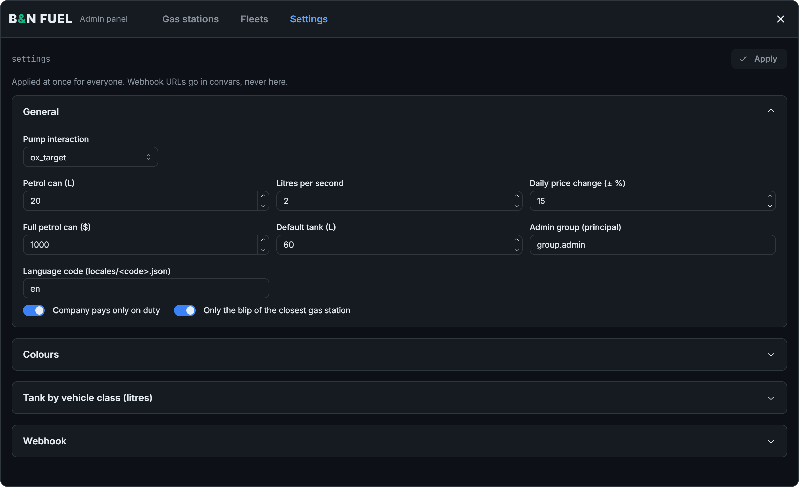
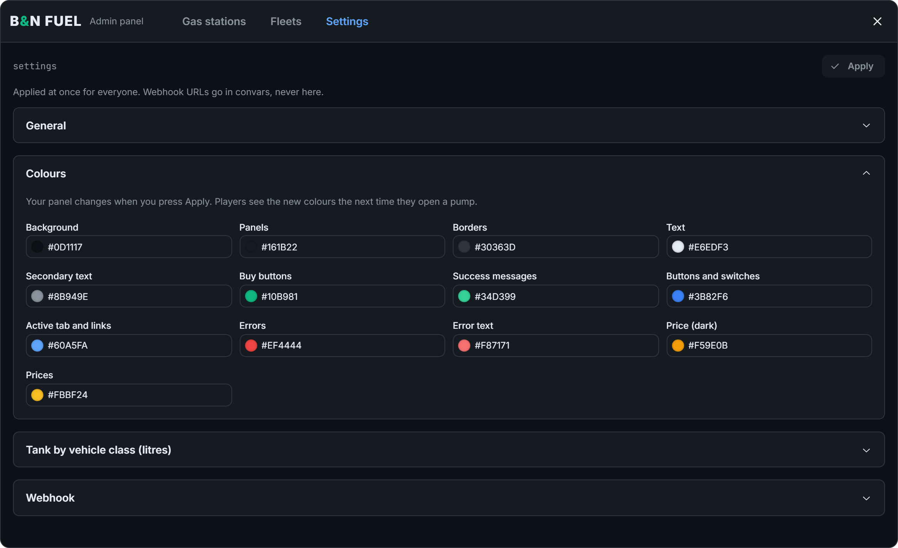
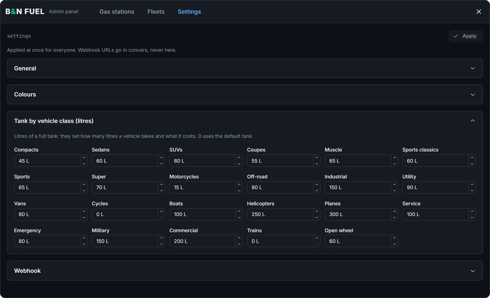

# Settings

Most options are in `/admin:fuel` > Settings and apply at once when you press **Apply**. The rest are in `shared/config.lua` and need a `restart bn_fuel`.

## General

| Option | Default | What it does |
|---|---|---|
| Pump interaction | ox_target | ox_target or Text UI. See [Interaction modes](#interaction-modes) |
| Daily price change | 15 | How much a station's price can move each day, in ± % |
| Litres per second | 2 | Fuelling speed |
| Default tank | 60 | Litres for a vehicle class whose tank is 0 |
| Full petrol can | 1000 | Price of a new can, in $ |
| Petrol can | 20 | Litres in a full can |
| Language code | en | The file used from `locales/`. See [Languages](languages.md) |
| Admin group | group.admin | The group that can open the panel |
| Only the blip of the closest gas station | On | Shows one blip that follows the player. Off shows all active stations |
| Company pays only on duty | On | The Company option needs the player on duty |

## Interaction modes

| Mode | Pump | Petrol can |
|---|---|---|
| ox_target | "Use pump" option on the pump | "Pour petrol can" option on the vehicle |
| Text UI | Prompt next to the pump; press the interact key | Prompt next to the fuel cap; press the interact key |

If the mode is ox_target but `ox_target` is not running, the script uses Text UI and prints a warning in the player's F8 console.

The interact key is only used in Text UI mode. It is **E** by default, and players can rebind it in Settings > Key Bindings > FiveM.

## Colours

Change any interface colour and press **Apply**. Your panel changes at once, and players see the new colours the next time they open a pump. A value that is not `#RRGGBB` is not saved.

## Tanks

Litres of a full tank for each vehicle class. They set how many litres a vehicle takes and what it costs. A value of 0 uses the default tank.

| Class | Litres | Class | Litres |
|---|---|---|---|
| Compacts | 45 | Industrial | 150 |
| Sedans | 60 | Utility | 90 |
| SUVs | 80 | Vans | 80 |
| Coupes | 55 | Cycles | 0 |
| Muscle | 65 | Boats | 100 |
| Sports classics | 60 | Helicopters | 250 |
| Sports | 65 | Planes | 300 |
| Super | 70 | Service | 100 |
| Motorcycles | 15 | Emergency | 80 |
| Off-road | 80 | Military | 150 |
| Commercial | 200 | Trains | 0 |
| Open wheel | 60 | | |

## Webhook

Turn each type of log on or off and send a test message. See [Discord logs](discord-logs.md).

## Config file

These options are in `shared/config.lua`.

| Option | Default | What it does |
|---|---|---|
| `Shared.AdminCommand` | `admin:fuel` | The panel command |
| `Shared.RequireOptin` | `true` | The panel needs the admin to be opted in |
| `Shared.OptinCommand` | `optin` | The opt-in command shown in the warning |
| `Shared.Bank` | `renewed` | The bank file used from `bridge/banks/` |
| `Shared.VehicleDistance` | `6.0` | How far from the player the vehicle can be, in metres |
| `Shared.PumpDistance` | `2.5` | How close the player must be to the pump, in metres |
| `Shared.CapDistance` | `1.8` | How close the player must be to the fuel cap to pour, in metres |
| `Shared.MinTimeShare` | `0.85` | From this share of the time, an action counts as complete |
| `Shared.CanSeconds` | `5` | Seconds to fill a petrol can |
| `Shared.ConsumptionRate` | `10.0` | How fast vehicles use fuel. Higher uses more |
| `Shared.InteractKey` | `E` | Default interact key in Text UI mode |
| `Shared.PumpModels` | 7 models | The objects that count as pumps. Add yours for custom gas stations |
